  

### 👋 Hey, I'm Wudu — aka **Genjuzu**

Coder from Hamburg, building immersive virtual worlds, live AI avatars, and quiet on-device agents. When I'm not pushing pixels or tokens, I produce music and write dark mythic fiction.

---

### 🎯 Current Missions

> Progress is computed from issues labeled `mission:<id>`: **closed / (open + closed)**.
> Open an issue to start a task, close it to push the bar up. With no issues yet, the last manual value is shown. The card is regenerated by a GitHub Action on every push.

---

### 🧪 Tinkering with right now

- **Multivox** — spatial audio voxel engine experiments
- **LivePortrait** fork — animating portraits for avatar tests
- **Avatar turnaround & FaceLift** refinement in Colab
- **App-Manufaktur** — multi-bot app factory playbook

---

### 🧰 Stack & Skills

> Aggregated from all of Wudu's repos. Language shares are computed automatically; the toolbox is curated in [`profile/stack.json`](profile/stack.json). Add a `GH_PAT` secret to also include private repos — only aggregate numbers are shown, never repo names.

---

### 📊 GitHub Pulse

  
  

### 🔥 Daily activity

---

### 🎵 Music · ✍️ Fiction

| 🎧 Producing | 📖 Writing |
| --- | --- |
| Building lossless Suno catalogue workflows & batch tools | **Book of Tammuz** — a mythic novel |
| Festival DJ gig-acquisition automations for the DACH scene | Dark, layered storytelling with a multi-agent drafting rig |

---

### 🛰️ Elsewhere

- 📍 Hamburg, Germany
- 💬 German · English
- 🚀 I love experimenting at the frontier of emerging tech and leaving new digital footprints behind.

---

*Profile visuals are generated by a small Node renderer — see [`scripts/render-progress.mjs`](scripts/render-progress.mjs).*
